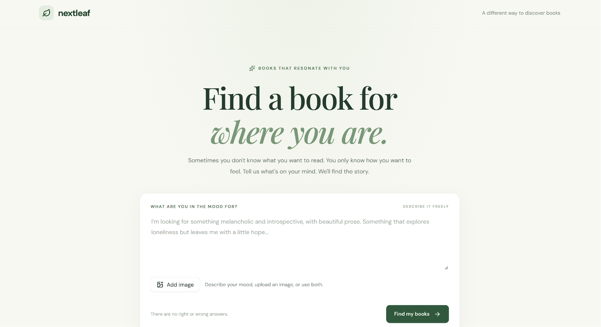

# NextLeaf 🍃

### Find a book for where you are.



NextLeaf is a multi-modal emotion-aware literary book recommender that helps readers discover books based on how they want to feel, what they want to explore, and the kind of reading experience they're looking for.

Instead of searching only by genre, author, or popularity, readers can describe a mood in natural language, upload an image for inspiration, or combine both.

NextLeaf translates these inputs into semantic and emotional signals and retrieves books that best match the intended reading experience.

## ✨ Features

- **Natural-language discovery:** Describe a feeling, mood, theme, or desired reading experience.
- **Image-based discovery:** Upload an image and let the vision model interpret its atmosphere and emotional cues.
- **Combined text and image input:** Use a written description and an image together.
- **Emotion-aware recommendations:** Match books across 14 reading-experience dimensions.
- **Semantic retrieval:** Separate content and reading-experience embeddings help retrieve relevant books.
- **Literary enrichment:** Each book includes an enriched description, themes, and reading-experience profile.

## 🧠 How it works

1. **Input:** The reader provides a text prompt, an image, or both.
2. **Image interpretation:** When an image is provided, Muse Spark interprets its atmosphere and converts it into a textual description.
3. **Query interpretation:** Muse Spark converts the combined input into content intent, experience intent, and trait preferences.
4. **Semantic retrieval:** The system generates separate embeddings for content and reading experience.
5. **Trait matching:** The reader's preferences are compared against each book's 14-dimensional reading-experience profile.
6. **Ranking:** Reciprocal Rank Fusion combines the retrieval rankings into a final recommendation list.

### The 14 reading-experience dimensions

| Category | Dimensions |
|---|---|
| Feel | Emotional intensity, darkness, hope/coziness, humour, tension/suspense |
| Drive | Pace, action/violence, romance/spice |
| Craft | Prose density, character depth, plot complexity, world immersion |
| Mind | Philosophical depth, weirdness/experimentalism |

It uses python, fastapi in the backend with sqlite as database (with metadata and embedding, for large scale applications, vector databases or even pgsql database can be used) and react frontend.


## 🚀 Getting started

### Prerequisites

- Python 3.12+
- [uv](https://docs.astral.sh/uv/)
- Node.js and npm
- A Meta API key with access to Muse Spark

### 1. Clone the repository

```bash
git clone <this-github-repository-url>
cd NextLeaf
```

### 2. Install backend dependencies

From the project root:

```powershell
uv sync
```

### 3. Configure environment variables

Create `backend/.env`:

```env
META_API_KEY=your_meta_api_key
META_MODEL=muse-spark-1.3
```

### 4. Add the recommendation database

Place your populated SQLite database at:

```text
data/goodreads_catalog.sqlite
```

The database is generated through the data preparation and enrichment pipeline. See [data/README.md](data/README.md).

### 5. Start the backend

From the project root:

```powershell
uv run --project . uvicorn app.main:app --reload --app-dir backend
```

The API will be available at:

```text
http://127.0.0.1:8000
```

FastAPI interactive documentation:

```text
http://127.0.0.1:8000/docs
```

### 6. Install frontend dependencies

Open another terminal:

```powershell
cd frontend
npm install
```

Create `frontend/.env`:

```env
VITE_API_BASE_URL=http://127.0.0.1:8000
```

### 7. Start the frontend

```powershell
npm run dev
```

Open:

```text
http://localhost:5173
```

## 🔌 API

### `POST /api/recommend`

Generate personalized book recommendations.

Accepts `multipart/form-data`.

| Parameter | Type | Description |
|---|---|---|
| `query` | String | Optional natural-language reading request |
| `image` | File | Optional JPEG, PNG, or WEBP image |
| `top_k` | Integer | Number of recommendations (1–20, default 10) |

At least one of `query` or `image` must be provided.

Images are limited to 5 MB.

### Other endpoints

- `GET /health` — Backend health check.
- `GET /api/books/{work_id}` — Retrieve book details.
- `POST /api/feedback` — Submit recommendation feedback.


## 📚 Data preparation

The catalogue is built from Goodreads metadata and review statistics. Book descriptions, themes, reading-experience traits, and embeddings are generated in a separate enrichment pipeline.

See [data/README.md](data/README.md) for the data preparation workflow.

## Work to be done in the future

- Make the recommendations more personalized by adding a taste vector for each user.
- Improve book seeding latency by using multithreading and seed more books.
- Experiment with different embeddings and ranking formulas and methods.

## 🌱 Project philosophy

A book recommendation should be more than a genre match.

Sometimes readers search for a story that understands their loneliness, offers comfort, challenges their thinking, or transports them somewhere unfamiliar.

**NextLeaf helps readers find stories that resonate with where they are.**
